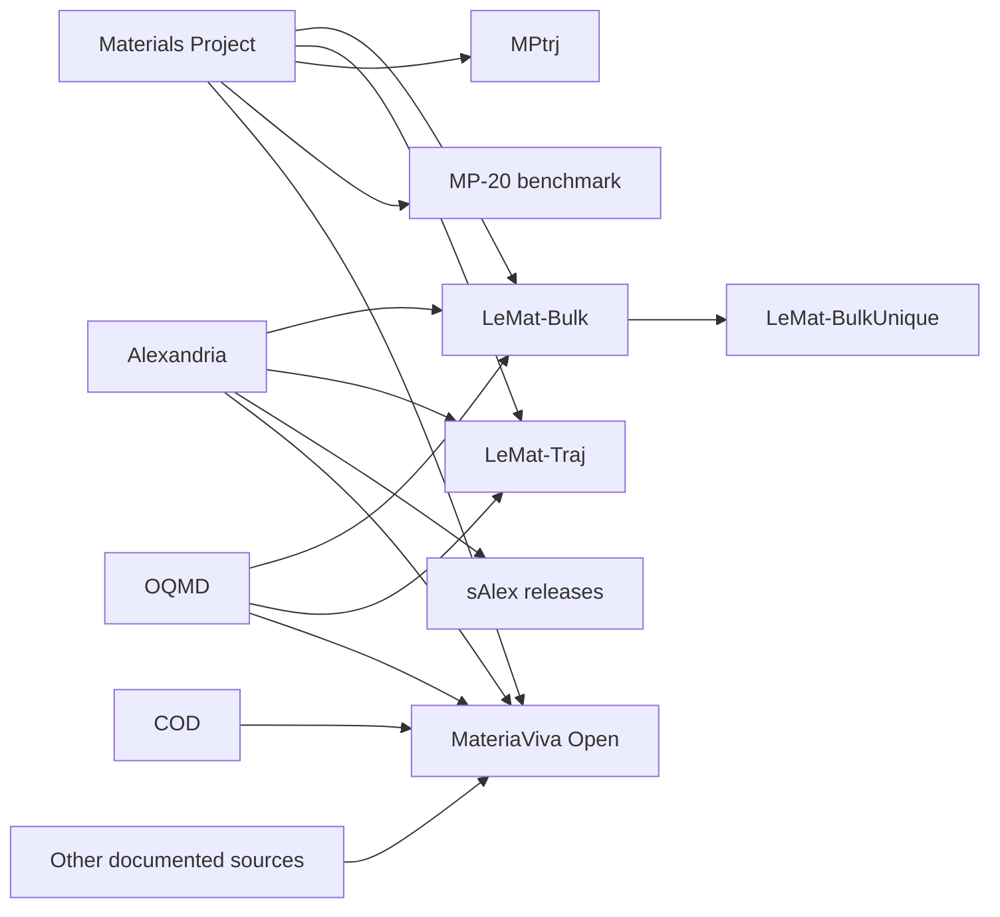

# Dataset lineage and overlapping counts

These selected relationships follow provider documentation. Arrows indicate derivation or aggregation, not that every source record is retained.

The [LeMat](https://lematerial.org/docs/about/datasets/), [MPtrj](https://doi.org/10.6084/m9.figshare.23713842), [MP-20](https://github.com/txie-93/cdvae/tree/main/data/mp_20) and [MateriaViva](https://huggingface.co/datasets/AI4QC/MateriaViva-Open) documentation describe these relationships. Full overlap cannot be inferred from this small diagram.

Keep the source release and identifiers when joining records. Distinguish exact row duplicates from symmetry-equivalent structures, repeated compositions and related prototypes. Split by the level appropriate to the scientific question: a random frame split, held-out material, held-out chemical system and held-out prototype test different forms of generalization.

Alternate functional labels and coordinate variants can be useful paired data, but do not automatically increase chemical diversity. Experimental determinations at different temperatures may be scientifically distinct even when a structural matcher merges them. Deduplication must follow the intended use and preserve the originals' provenance.

## Superconductivity lineage

SuperCon is an upstream measurement collection; the UCI feature table and 3DSC matches are derivatives with different row and structure units. The [3DSC release](https://github.com/aimat-lab/3DSC) matches experimental labels to Materials Project and ICSD structures, sometimes with artificial doping. Its MP and ICSD branches reuse labels and overlapping compositions, so their record counts are not additive. Randomly splitting matched structures can also place the same composition or label in training and testing.

Computed electron–phonon collections and learned-model releases introduce another layer of reuse. A structure file distributed with a model need not contain its target labels, and an Allen–Dynes or Eliashberg critical temperature is a calculated quantity under a stated protocol. High-pressure hydride results must retain pressure and dynamical-stability context when compared with ambient-pressure materials. The [superconductivity supplement](superconductivity.md) documents source-specific units, pressure limits and upstream relationships, including Hennig-group model releases and their parent calculation sets.

[Back to MatVerse](../README.md)

## JARVIS access layers and historical mirrors

The [complete JARVIS audit](jarvis-coverage.md) maps the homepage database rows and all entries in the linked Figshare table. The download registry includes mirrors of AFLOW, Alexandria, COD, Materials Project, OQMD and other sources. These mirrors can differ in date, schema and subset selection; their sizes are not new material totals to add to the parent database. JARVIS-DFT2 and Universal Search are alternate access layers. The [API directory](api-access.md) distinguishes these navigation and machine-access routes from ranked data releases.
