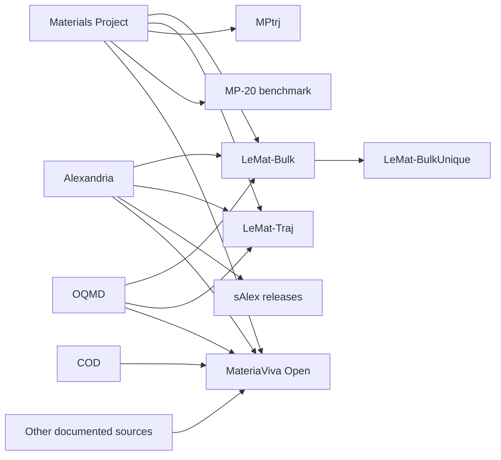

# Dataset lineage and overlapping counts

These selected relationships follow provider documentation. Arrows indicate derivation or aggregation, not that every source record is retained.

The [LeMat](https://lematerial.org/docs/about/datasets/), [MPtrj](https://doi.org/10.6084/m9.figshare.23713842), [MP-20](https://github.com/txie-93/cdvae/tree/main/data/mp_20) and [MateriaViva](https://huggingface.co/datasets/AI4QC/MateriaViva-Open) documentation describe these relationships. Full overlap cannot be inferred from this small diagram.

Keep the source release and identifiers when joining records. Distinguish exact row duplicates from symmetry-equivalent structures, repeated compositions and related prototypes. Split by the level appropriate to the scientific question: a random frame split, held-out material, held-out chemical system and held-out prototype test different forms of generalization.

Alternate functional labels and coordinate variants can be useful paired data, but do not automatically increase chemical diversity. Experimental determinations at different temperatures may be scientifically distinct even when a structural matcher merges them. Deduplication must follow the intended use and preserve the originals' provenance.

[Back to MatVerse](../README.md)
